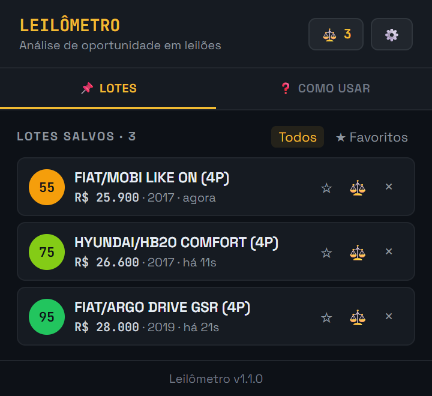

# Leilômetro — Extensão Chrome

> Análise de leilões de veículos em tempo real: custo total, preço limite de lance e KM/ano direto na página do lote.

[](https://chromewebstore.google.com/detail/oifmcimfbbbjenddghinhddmmihfolpi/)
[](https://leilometro.com.br)
[](https://github.com/paulpessoa/leilometro-extensao/actions/workflows/ci.yml)


O **Leilômetro** é uma ferramenta para arrematantes de leilões de veículos. Ela abre um painel na página do lote no [leilo.com.br](https://leilo.com.br) e ajuda a decidir o lance pelos números, não pela emoção. JavaScript puro (sem build), com cálculo isolado em `lib/calc.js` e coberto por testes.

<p align="center">
  
</p>

| Painel no lote | Popup da extensão |
|---|---|
|  |  |

## ⚙️ Como funciona

- **Content scripts** (`content/`): rodam em `leilo.com.br`, identificam o lote aberto, buscam os dados na API pública do site (`lib/api.js`) e desenham o painel injetado, o Modo Leilão e o balão do assistente.
- **Service worker** (`background.js`): badge, notificações, alarmes de lembrete e as chamadas de IA (`lib/ai.js`), que só rodam aqui.
- **Armazenamento**: `chrome.storage.local` para lotes, anotações e alertas; `chrome.storage.sync` para a configuração, com backup/importação em JSON. Não há servidor próprio.
- **Regras de cálculo** (`lib/calc.js`): funções puras, sem DOM, reaproveitadas pelo painel, comparador, relatório e testes.
- **Integração com o site**: `leilometro.com.br` pode perguntar à extensão se ela está instalada (mensagem `leilometro_ping`, que devolve apenas a versão).

## 🔒 Permissões e privacidade

| Permissão | Para que serve |
|---|---|
| `storage` | Guardar lotes, anotações e configurações no navegador |
| `notifications` | Avisos do Modo Leilão e lembretes de encerramento |
| `alarms` | Disparar o lembrete X minutos antes do encerramento, mesmo com a aba fechada |
| Host `*.leilo.com.br` | Ler o lote aberto e consultar a API do site |
| Opcionais: `api.openai.com`, `generativelanguage.googleapis.com` | Só pedidas se você ativar o assistente de IA, com a sua própria chave |
| `externally_connectable` (`www.leilometro.com.br`) | Permite ao site detectar se a extensão está instalada |

Lotes e anotações ficam no navegador. Nenhum dado é enviado a servidores do Leilômetro; a única saída é para o provedor de IA que você escolher, e só quando você usa o assistente. Detalhes e justificativas da loja em [docs/CHROME_WEB_STORE.md](docs/CHROME_WEB_STORE.md).

## 🚀 Funcionalidades

- **Custo no leilão:** lance + comissão + taxas do lote (lidas da API do site; bate com o "total a pagar").
- **Preço limite:** o maior lance em que você ainda lucra a margem desejada, já descontando comissão, taxas e custos pós-arremate (conserto, documentação, IPVA).
- **Meu teto:** um limite pessoal opcional, usado pelos alertas.
- **Score de oportunidade (0–100)** e **análise de KM/ano** (particular, frota, aplicativo).
- **Sinais de atenção:** lote **sem vídeo** (normalmente o carro não liga ou não anda), sem chave, sem laudo cautelar, laudo reprovado ou com observações. O score não muda, mas o selo de oportunidade avisa "com sinais de risco".
- **Lembrete:** marque ⏰/★ e receba uma notificação X minutos antes do encerramento previsto, mesmo com a aba fechada.
- **Modo Leilão:** botão "Ativar rastreio" durante o pregão. Apita quando faltam N lances para o teto, quando passa do teto (som crítico), quando o lance chega num valor escolhido e 1 minuto antes do encerramento previsto. Também envia notificação do sistema, muda o título da aba e mostra gráfico e ritmo dos lances.
- **Modo compacto:** uma barra com lance, teto, lances restantes e score, colorida pela situação.
- **Comparador:** até vários veículos lado a lado, com o melhor/pior de cada item destacado, edição de FIPE/teto/conserto na tabela e exportação para CSV.
- **Relatório:** página para imprimir/salvar em PDF ou copiar um resumo para o WhatsApp.
- **Assistente de IA (opcional, chave própria da OpenAI ou do Gemini):** veredito, riscos, teto sugerido, checklist de vistoria, comparação com os lotes salvos, ranking no comparador e parecer no relatório.
- **Dados locais:** lotes, anotações e alertas ficam no navegador (`chrome.storage.local`), com backup/importação em JSON.

## 🛠️ Como instalar (modo desenvolvedor)

1. Baixe ou clone este repositório.
2. Abra `chrome://extensions/` e ative o **Modo do desenvolvedor**.
3. Clique em **Carregar sem compactação** e selecione a pasta do repositório.
4. Se a versão da Chrome Web Store estiver instalada, desative-a para não haver dois painéis.
5. Abra um lote, por exemplo `https://leilo.com.br/lote/<id>/`.

Atalho: `Ctrl+Shift+L` abre/fecha o painel.

## 📂 Estrutura

| Caminho | O que é |
|---|---|
| `manifest.json` | Manifest V3 |
| `background.js` | Service worker: abre páginas, badge, notificações e chamadas de IA |
| `lib/util.js` | Formatação, escape de HTML, mini-markdown |
| `lib/calc.js` | Regras de cálculo (sem DOM), usadas em todo lugar e nos testes |
| `lib/api.js` | Leitura da API pública do leilo.com.br (`/v1/lote/by-id/<uuid>`) |
| `lib/storage.js` | Armazenamento (`lot:<id>`, configuração, estado do painel, IA) e migração da v1.0 |
| `lib/sound.js` | Sons de alerta via Web Audio |
| `lib/ai.js` | Prompts e adaptadores OpenAI/Gemini (só roda no service worker) |
| `content/` | Painel na página: `scrape.js` (rota/DOM), `panel.js`, `live.js` (Modo Leilão), `assistant.js` (balão 🤖), `main.js` (inicialização) |
| `popup/` | Lista de lotes salvos |
| `options/` | Configurações: cálculo, alertas, IA, backup |
| `compare/` | Comparador |
| `report/` | Relatório imprimível |
| `welcome/` | Boas-vindas (abre ao instalar) |
| `styles.css` | Estilo do painel injetado |
| `ui/pages.css` | Estilo das páginas da extensão |
| `tests/` | Testes (`node --test "tests/*.test.js"`) |
| `scripts/empacotar.mjs` | Gera o zip para a Chrome Web Store |
| `docs/amostra-api-lote.json` | Resposta real da API, usada nos testes |

Quando o site mudar o layout, veja `DIAGNOSTICO_LEILO.md` (seletores) e `content/scrape.js`.

## 🧪 Testes

```bash
node --test "tests/*.test.js"
```

Para simular lances no Modo Leilão sem um pregão real, rode no console da página do lote com o rastreio ligado:

```js
localStorage.setItem("lm_debug", "1")
document.dispatchEvent(new CustomEvent("leilometro:simular", { detail: 40000 }))
```

## 📦 Empacotar para a Chrome Web Store

```bash
node scripts/empacotar.mjs   # gera dist/leilometro-<versão>.zip
```

Textos da ficha da loja, justificativas de permissão e formulário de privacidade: [docs/CHROME_WEB_STORE.md](docs/CHROME_WEB_STORE.md).


## 📄 Licença

Este projeto é para uso pessoal e profissional de arrematantes. Consulte os termos de uso na nossa Landing Page.

---
Desenvolvido por [Paul Pessoa](https://github.com/paulpessoa)
